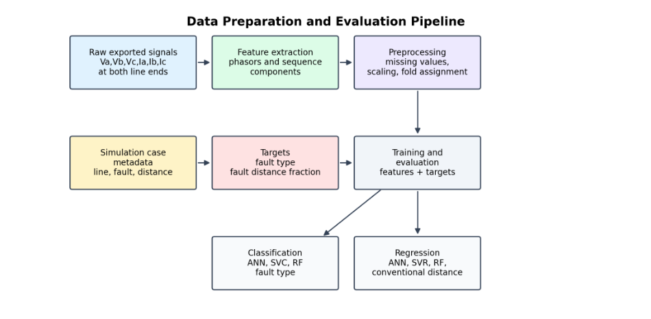
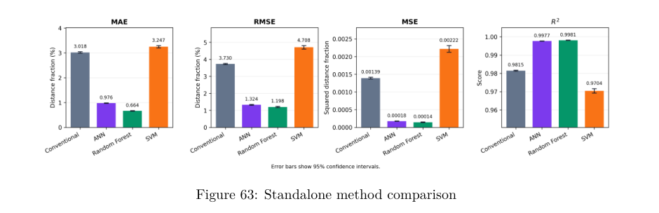

# Power System Fault Location with Machine Learning

An academic team project comparing impedance-based fault location, machine-learning estimators, and hybrid residual correction on the IEEE 39-bus New England transmission network. The study includes an inverter-based renewable-generation scenario.

**Package status:** MATLAB network parameters, a Simulink model, research documentation and a small data sample. The Python training and automated dataset-generation scripts are still missing, so this repository does not currently reproduce the thesis experiments end to end.

## What the project does

- Simulates transmission-line faults and collects sending-end and receiving-end voltage/current measurements.
- Extracts phasors and symmetrical-component features before and after the fault.
- Compares conventional impedance calculations with Artificial Neural Networks, Support Vector Machines and Random Forests.
- Studies a hybrid approach that learns the residual error of a conventional estimate.
- Evaluates fault classification, fault-distance error and sensitivity to measurement noise.



## Tools used

The thesis describes MATLAB and Simulink for network modeling, operating-point preparation and automated fault simulation; Python and scikit-learn for machine-learning workflows; and Matplotlib for visualization. Spyder and Anaconda were used as development/environment tools. A saved experimental ANN in the supplied folders is in Keras format, but its configuration differs from the final thesis and it is not included.

The supplied model was saved with MATLAB R2024a and references Simscape Electrical Specialized Power Systems libraries (including synchronous machines, excitation systems, stabilizers, lines and faults). Use a MATLAB/Simulink installation with those libraries. Compatibility with other releases has not been tested. The Python runtime versions and exact ANN training dependencies still need confirmation from the source scripts. No unverified dependency list is presented as a working training environment.

## Included files

| File | Purpose |
| --- | --- |
| [Network parameters](simulation/ieee39_network_parameters.m) | IEEE 39-bus line, machine, load and controller parameters |
| [Simulink model](simulation/ieee39_fault_location.slx) | Supplied network and fault-simulation model; saved in R2024a |
| [Technical thesis](docs/fault-location-thesis.pdf) | Anonymous technical edition with methodology, results, bibliography and system diagrams |
| [Feature sample](data/fault-feature-sample.csv) | 110 illustrative simulation cases with local paths removed |
| [Sample description](data/sample-description.json) | Selection method, dimensions and removed columns |
| [Dataset summary](data/dataset-summary.json) | Supplied case counts, fault classes and network-line coverage |
| [Data guide](docs/data-guide.md) | Columns, targets and evaluation cautions |
| [File selection](docs/file-selection.md) | What was retained, excluded and still needs to be added |

## Results reported in the thesis

These values are transcribed from the thesis, not reproduced by this repository. The main experiment uses 21,317 retained cases; the renewable study uses a separate 1,140-case subset.

| Main-dataset method | Distance MAE (% of line length) | Fault-classification accuracy (%) |
| --- | ---: | ---: |
| Conventional impedance | 3.018 | Not applicable |
| ANN | 0.976 | 99.099 |
| Random Forest | 0.664 | 98.274 |
| SVM | 3.247 | 98.494 |

Source: original thesis printed page 110. Full confidence intervals and timing definitions are in the report.



The renewable hybrid RF experiment reports a distance MAE of 0.132% of line length. **Its folds differ from the standalone renewable RF experiment**, so those rows are not a controlled model ranking under identical validation splits. See original printed pages 121–122.

## How to explore this package

1. Read the thesis and data guide.
2. Open `data/fault-feature-sample.csv` in a spreadsheet or CSV viewer.
3. Use `fault_type` for the classification label and `true_distance_fraction` for the normalized distance target. Keep target columns and metadata out of a feature matrix.
4. Treat the sample only as a format demonstration. It is too small and deliberately selected to reproduce neither the thesis metrics nor a meaningful train/test evaluation.

## Open the network model

In MATLAB, set the current folder to this repository, then run:

```matlab
cd simulation
ieee39_network_parameters
open_system('ieee39_fault_location.slx')
```

The model's preload callback also runs the parameter script and initializes its stabilizer-selection flags. Keep the two files together. Review the model's fault blocks, operating point and solver settings before running a case. Opening this model does not generate the thesis dataset or train the estimators; the original sweep, export and Python pipelines remain to be supplied.

The parameter values and model dynamics were preserved. The model filename, preload reference and saved diagram paths were updated, and creator/editor metadata was cleared. ZIP integrity, XML parsing and the renamed initialization reference passed static checks. MATLAB/Simulink execution has not been validated.

## Methodology limits

The thesis's main validation distributes cases from known modeled lines across five folds. It evaluates interpolation to new simulated fault cases on those lines, not generalization to entirely unseen lines or field deployment. Fit imputation and scaling only on each training fold. Fault resistance appears among the study features; its availability in a deployed measurement pipeline must be assessed.

Saved experimental summaries found during preparation have configurations and scores different from the final thesis. They are not included as evidence for the table above. Simulations, training and reported performance have not been rerun or independently validated here.

## Project context

This is collaborative academic work. Personal cover pages, dedications, acknowledgements and document metadata are omitted from the public report. Scholarly references and their attribution remain. No new software license or claim of sole authorship has been added.
